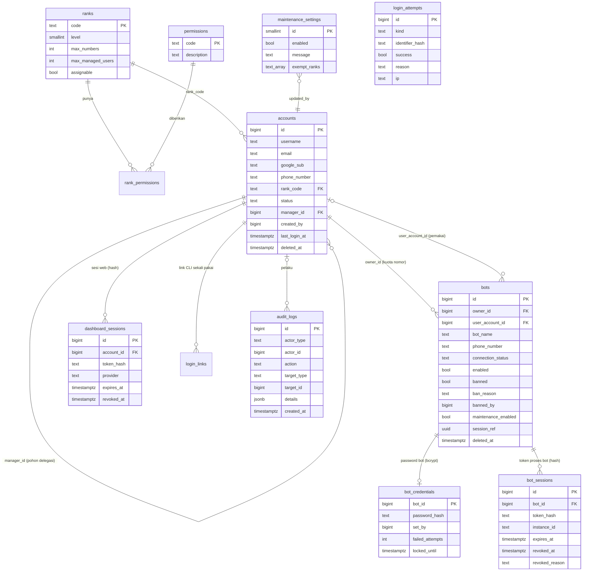

# Database pusat (PostgreSQL)

Migrasi: `server/migrations/001_core.sql` (skema) dan `002_ranks_permissions.sql` (seed rank & permission).
Runner: `server/lib/migrate.js` — satu transaksi per file, `pg_advisory_xact_lock` agar dua proses tidak migrasi bersamaan, dan **menolak** jalan bila file yang sudah diterapkan berubah (checksum di `schema_migrations`). Perubahan skema berikutnya = file baru `003_*.sql`.

## ERD

## Tabel & integritas

| Tabel | Fungsi | Constraint / index penting |
|---|---|---|
| `ranks` | 6 rank, level, kuota (`NULL` = unlimited), `assignable` | `CHECK code IN (...)`, `level UNIQUE` |
| `permissions`, `rank_permissions` | daftar permission eksplisit & relasi rank→permission | PK gabungan, FK cascade |
| `accounts` | akun dashboard (users) | unik parsial `username`/`email`/`phone_number` untuk baris belum dihapus; `google_sub` unik di **semua** baris (akun dihapus tidak bisa daftar ulang diam-diam); `CHECK` format username/email/nomor; `manager_id <> id`; status `active/disabled/suspended/banned` |
| `bots` | nomor/instance WhatsApp | `bots_phone_uq` unik parsial (nomor boleh didaftar ulang setelah soft-delete); FK `owner_id` **RESTRICT**; `CHECK` banned ⇒ `banned_at`, disabled ⇒ `disabled_at`; `session_ref` uuid opaque (isi session tidak disimpan) |
| `bot_credentials` | password bot terpisah dari login web | `CHECK` hanya format hash bcrypt (plaintext ditolak di level DB) |
| `bot_sessions` | token proses bot | hanya SHA-256 token; `instance_id` untuk lease satu-proses; bisa dicabut (`revoked_reason`) |
| `dashboard_sessions` | sesi web | hanya SHA-256 token; masa berlaku; bisa dicabut |
| `login_links` | link login CLI sekali pakai (15 menit) | hash token, `used_at` |
| `maintenance_settings` | maintenance global (1 baris) + pengecualian rank | `CHECK id = 1` |
| `audit_logs` | jejak aksi sensitif | **append-only** (trigger menolak UPDATE/DELETE); detail disaring dari key mirip secret |
| `login_attempts` | brute-force guard | identifier disimpan sebagai hash, bukan nomor mentah |

## Kebijakan hapus

- `accounts`, `bots`: **soft-delete** (`deleted_at`, `deleted_by`). Akun yang masih mengelola user/nomor tidak bisa dihapus (`409 HAS_DEPENDENTS`).
- Hard-delete hanya lewat `node server/cli.js purge --days N` (bot yang sudah lama soft-delete, sesi kedaluwarsa/dicabut, login attempts lama). Audit log tidak pernah dihapus aplikasi.

## Transaksi & concurrency

Semua mutasi terkait (mis. ban bot + cabut sesi + audit) berada dalam satu transaksi (`db.withTransaction`). Penambahan resource mengunci baris akun pemilik kuota (`FOR UPDATE`). Login bot mengunci baris bot untuk menyerialkan lease instance.

## Pemisahan environment

- Development/production: `DATABASE_URL` (+ `DATABASE_SCHEMA` opsional). Gunakan **database terpisah** dari platform APIZ2Z.
- Test: `TEST_DATABASE_URL`; setiap file test membuat schema acak lalu menghapusnya. Test menolak jalan bila `TEST_DATABASE_URL == DATABASE_URL`.

## Backup & restore

1. **Fisik (disarankan untuk production)**: `pg_dump -Fc "$DATABASE_URL" > yannajah-$(date +%F).dump` terjadwal (cron) ke penyimpanan terpisah; restore dengan `pg_restore -d <db_baru> file.dump`.
2. **Logis terenkripsi (bawaan)**: `node server/cli.js backup --out file.json.enc` (AES-256-GCM, kunci `BACKUP_ENCRYPTION_KEY`) atau tombol di dashboard (DEVELOPER). Isi: ranks, rank_permissions, accounts, bots, bot_credentials (hash), maintenance, audit_logs. Sesi tidak ikut (semua login ulang).
   Restore hanya ke database **kosong yang sudah dimigrasi**: `npm run migrate` → `node server/cli.js restore --in file.json.enc --confirm-empty`. Teruji otomatis (`tests/server/database-ops.test.js`).

Rollback migrasi: migrasi 001/002 hanya membuat objek baru. Untuk rollback deployment, pulihkan dump sebelum migrasi ke database baru dan arahkan `DATABASE_URL` ke sana (jangan menjalankan perintah destruktif di database produksi).
